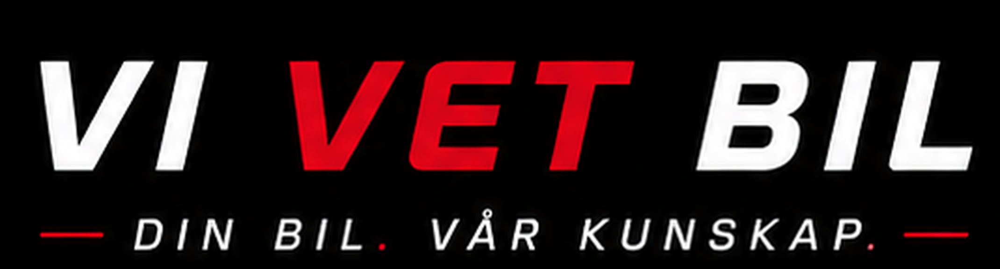

# Användning i VVB-projekt

## PDFNoodle / HTML till PDF

<!-- coderabbit-ai-generated:v1 -->

<!-- coderabbit-ai-generated-section:v1:0e2f99899c700ea9b286441bf879d618b21f0fabdd86cdbc0ae5cacd82f94748 -->

Följ den godkända standarden i `assets/vvb-brand-standard-v1/VVB-BRAND-STANDARD.md` (sökvägar nedan är relativa repots rot).

Använd `assets/vvb-brand-standard-v1/assets/primary/vvb-logo-horizontal-small.png` för faktura-/servicedokument-header. Loggan har svart bakgrund och ska placeras på svart yta (#000–#111), aldrig på vit bakgrund:

<!-- /coderabbit-ai-generated:v1 -->

<!-- coderabbit-ai-generated:v1 -->

<!-- coderabbit-ai-generated-section:v1:2f5eb65e7fd08c66e8a902f8810a78abbd5b44bff7044953a607556a4048b80e -->

```text
https://raw.githubusercontent.com/vvb-1/vvb-brand-assets/main/assets/vvb-brand-standard-v1/assets/primary/vvb-logo-horizontal-small.png
```

Sätt explicit storlek i HTML/CSS enligt PDF best practices, exempel:

```html

```

```css
.vvb-logo {
  background: #000;
  width: 220px;
  height: auto;
  object-fit: contain;
  page-break-inside: avoid;
}
```

<!-- /coderabbit-ai-generated:v1 -->

## Webbfavicons

<!-- coderabbit-ai-generated:v1 -->

<!-- coderabbit-ai-generated-section:v1:52329405c21f9ac8f705a75bff05c8221bcb8c9b6683915267b22da28afbab01 -->

Använd `assets/vvb-brand-standard-v1/assets/primary/vvb-favicon-red.svg` eller `assets/vvb-brand-standard-v1/assets/primary/vvb-favicon-dark.svg` som SVG-favicon och `assets/vvb-brand-standard-v1/assets/primary/favicon.ico` som ICO-fallback. Kopiera valda filer till projektets public-root:

```html
<link rel="icon" type="image/svg+xml" href="/vvb-favicon-red.svg">
<link rel="icon" href="/favicon.ico" sizes="any">
```

För mörk SVG-variant, byt SVG-länkens filnamn till `vvb-favicon-dark.svg`.

Kompletterande PNG-ikoner, `apple-touch-icon.png` och `site.webmanifest` finns i `assets/vvb-logo-ratt-v4/favicons/`. Vid användning av manifestet, kopiera även ikonerna det refererar till. `assets/vvb-logo-ratt-v4/favicons/html-head-snippet.txt` kan användas som startpunkt för dessa komplement; använd faviconfilerna ovan för standardens favicon.

<!-- /coderabbit-ai-generated:v1 -->

## Förbud

- Skapa inte ny VVB-logotyp med AI.
- Ändra inte färger/form utan Kristians uttryckliga godkännande.
- Använd inte screenshot-crop som source om dessa assets finns.
